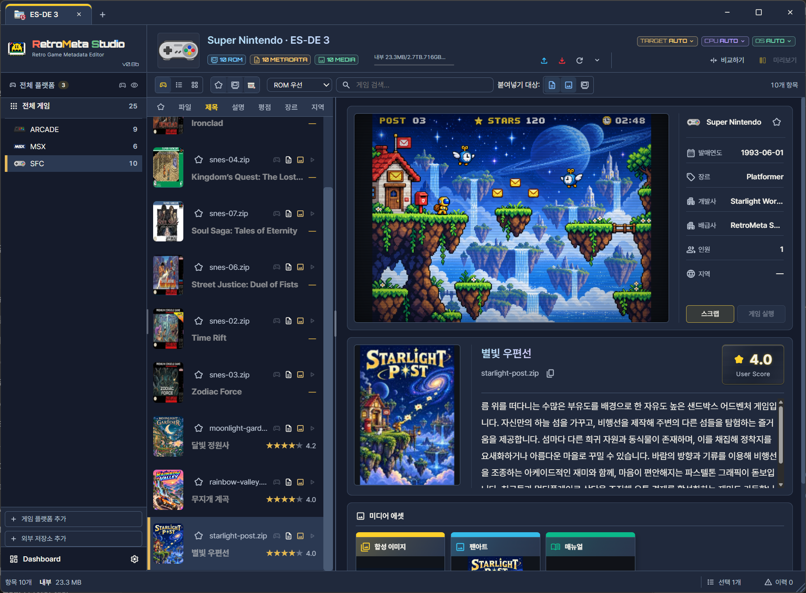
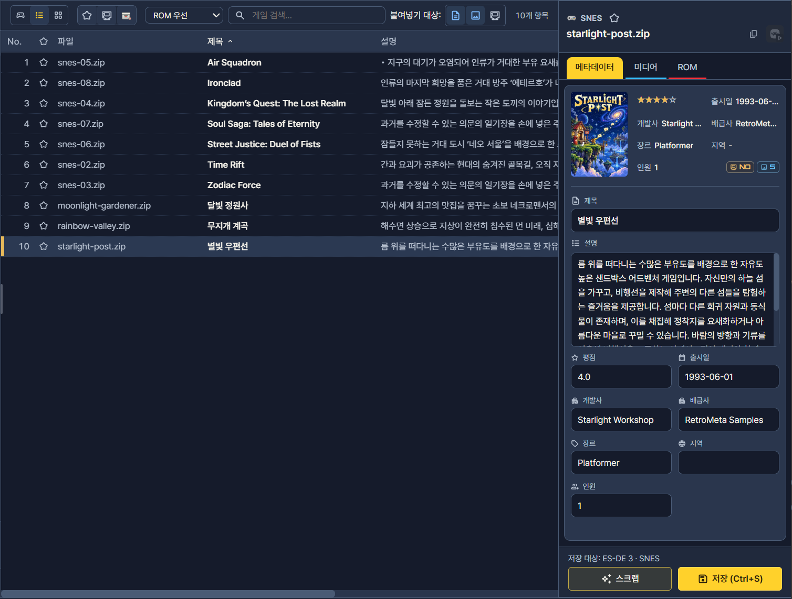
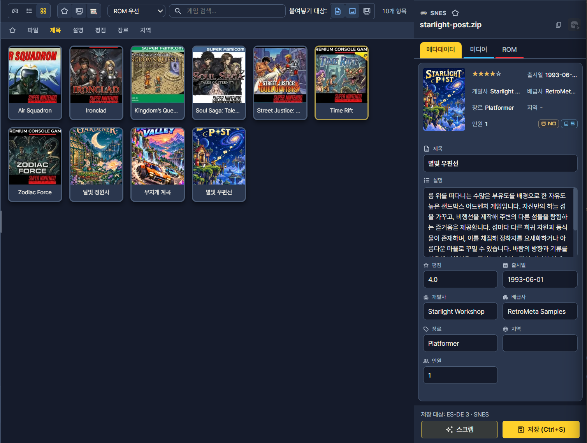
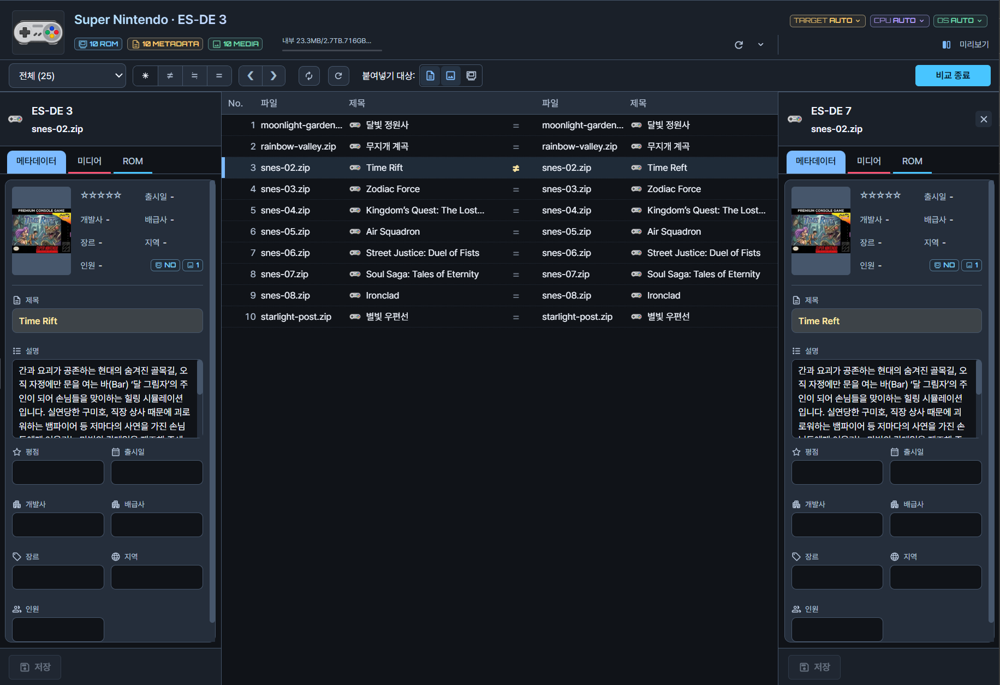

# RetroMeta Studio

**여러 게임목록을 한 화면에서 편집하고, 비교하고, 옮겨보세요.**

**ES-DE · EmulationStation · Pegasus · LaunchBox** 형식의 게임 메타데이터와 커버·미디어를 정리하고, 필요하면 ROM까지 관리하는 무료 Windows 앱입니다.

[English](README.md) · **한국어**

[**앱 소개**](https://moning-1664.github.io/retro-meta-studio-releases/v0.8/) · [**처음 사용하기**](https://moning-1664.github.io/retro-meta-studio-releases/v0.8/getting-started.html) · [**사용 설명서**](https://moning-1664.github.io/retro-meta-studio-releases/v0.8/manual/index.html) · [**다운로드**](https://github.com/moning-1664/retro-meta-studio-releases/releases) · [**질문하기**](https://github.com/moning-1664/retro-meta-studio-releases/discussions/categories/q-a)

> **v0.8 릴리즈를 준비하고 있습니다.** 아래 화면과 기능 소개는 v0.8b 개발판 기준입니다. **현재 다운로드 가능한 실행 파일은 v0.6b**이며, v0.8 설치 파일은 아직 공개되지 않았습니다.

## 작업에 맞춰 고르는 세 가지 보기

**아케이드**에서는 게임 화면·커버·설명을 함께 보고, **리스트**에서는 여러 게임의 정보를 표로 확인하고, **카드**에서는 커버를 중심으로 게임을 찾습니다. 같은 작업 공간에서 검색·필터·정렬과 상세 편집을 이어갈 수 있습니다.

| 리스트 보기 | 카드 보기 |
|---|---|
|  |  |
| 파일명·제목·평점 등 여러 열을 한눈에 확인합니다. | 커버를 보며 게임을 탐색합니다. |

## 이런 작업을 할 수 있습니다

| 하고 싶은 일 | 제공하는 기능 |
|---|---|
| **여러 게임목록 열기** | 폴더를 컬렉션(Collection)으로 등록하고 탭으로 오갑니다. 목록 형식에 맞춰 메타데이터·미디어·ROM 위치를 지정합니다. |
| **제목·설명·커버 편집** | 제목·설명·평점과 미디어를 수정합니다. 저장 대상을 확인하고 반영하며, 고급 편집에서 원본 메타데이터도 살펴볼 수 있습니다. |
| **두 목록 비교와 전송** | 두 컬렉션을 나란히 비교합니다. 전송 방향과 메타데이터·미디어·ROM 포함 범위를 고르고, 해당 작업의 충돌·덮어쓰기 처리 방식을 확인합니다. |
| **보관소에 모아 재사용** | 선택한 게임 정보와 미디어를 변경 이력과 함께 보관합니다. 같은 게임의 기록을 비교하고 우선 사용할 버전을 고릅니다. |
| **온라인 스크랩과 설명 번역** | ScreenScraper 후보를 비교해 필요한 정보와 미디어를 고릅니다. 설명을 CSV로 내보내 외부 도구에서 `translated` 열을 번역하고, 가져오기 검토 후 적용합니다. |
| **저장 공간과 기기 관리** | Dashboard에서 용량과 빈 항목을 확인하고 외부 저장소를 관리합니다. 지원되는 작업 범위에서 Android MTP·ADB 기기를 연결합니다. |
| **로컬 게임 실행과 파일 확인** | RetroArch·코어를 설정하고 시스템 또는 게임별 코어를 고릅니다. ROM의 SHA256도 확인할 수 있습니다. RetroArch·코어·ROM은 별도로 준비합니다. |

### 차이를 보고, 필요한 자료만 고르세요

복사·붙여넣기, 비교, 컬렉션에서 가져오기, 보관소 재사용은 목적이 다릅니다. [정보를 옮기는 방법 고르기](https://moning-1664.github.io/retro-meta-studio-releases/v0.8/manual/choose-transfer.html)에서 현재 작업에 맞는 방법을 고르고, 대상·방향·포함 자료를 확인한 뒤 적용하세요.

## 작은 게임목록부터 시작하기

1. 시작 화면의 **내 게임 목록 열기** 또는 탭 옆 **+**로 목록 폴더와 저장 형식을 지정합니다.
2. 시스템과 게임을 고른 뒤 제목이나 설명을 수정하고 저장 대상을 확인합니다.
3. 다른 목록과 비교하거나 복사하려면 두 번째 컬렉션을 엽니다. ROM 파일까지 관리할 때만 ROM 관리 범위를 켭니다.

[그림으로 보는 처음 사용하기](https://moning-1664.github.io/retro-meta-studio-releases/v0.8/getting-started.html)에는 샘플 다운로드가 있습니다. 자신의 게임목록을 사용하기 전에 열기·검색·편집·저장·복사를 연습할 수 있습니다. 샘플은 가상 게임의 메타데이터와 미디어로 구성되며 **ROM은 포함하지 않습니다.**

## 필요한 설명 바로 찾기

| 시작하기 | 편집 | 정보 옮기기 | 보관·관리 |
|---|---|---|---|
| [게임목록 열기](https://moning-1664.github.io/retro-meta-studio-releases/v0.8/manual/collections.html) | [메타데이터·미디어 편집](https://moning-1664.github.io/retro-meta-studio-releases/v0.8/manual/editing.html) | [복사·붙여넣기](https://moning-1664.github.io/retro-meta-studio-releases/v0.8/manual/clipboard.html) | [보관소와 변경 이력](https://moning-1664.github.io/retro-meta-studio-releases/v0.8/manual/archive.html) |
| [화면 구성](https://moning-1664.github.io/retro-meta-studio-releases/v0.8/manual/screens.html) | [온라인 스크랩](https://moning-1664.github.io/retro-meta-studio-releases/v0.8/manual/scrape.html) | [게임목록 비교](https://moning-1664.github.io/retro-meta-studio-releases/v0.8/manual/compare.html) | [파일 관리와 저장 공간](https://moning-1664.github.io/retro-meta-studio-releases/v0.8/manual/files.html) |
| [보기 모드와 탐색](https://moning-1664.github.io/retro-meta-studio-releases/v0.8/manual/views.html) | [Google Sheets로 CSV 번역](https://moning-1664.github.io/retro-meta-studio-releases/v0.8/manual/csv.html#google-sheets) | [컬렉션에서 가져오기](https://moning-1664.github.io/retro-meta-studio-releases/v0.8/manual/import.html) | [문제가 생겼을 때](https://moning-1664.github.io/retro-meta-studio-releases/v0.8/manual/troubleshooting.html) |

저장소 오른쪽 **About의 홈페이지 링크**에서도 사용 설명서를 바로 열 수 있습니다. [설명서 전체 목차](https://moning-1664.github.io/retro-meta-studio-releases/v0.8/manual/index.html) · [v0.8 개발 변경 내용](https://moning-1664.github.io/retro-meta-studio-releases/v0.8/release-notes.html)

## 다운로드와 지원 범위

- **현재 공개 배포: [Windows x64용 v0.6b](https://github.com/moning-1664/retro-meta-studio-releases/releases/tag/v0.6b).** 해당 릴리즈에 첨부된 Setup 또는 Portable ZIP을 사용하세요. GitHub의 **Code ZIP / Source code**는 실행 파일이 아닙니다.
- Python은 함께 제공됩니다. Microsoft WebView2를 사용하며, 런타임을 설치할 때 인터넷 연결이 필요할 수 있습니다.
- 위 v0.8 화면과 새 설명서는 개발판 기준이므로 v0.6b와 다를 수 있습니다. [v0.6b 사용법](HOW_TO_USE.ko.md) · [v0.6b 릴리즈 노트](RELEASE_NOTES.ko.md)
- 지원하는 게임목록 형식은 ES-DE·EmulationStation·Pegasus·LaunchBox입니다. 편집 가능한 항목과 작업 범위는 형식·저장소 연결 방식에 따라 다릅니다. 앱 자체는 Windows에서 실행합니다.
- ScreenScraper는 정상적인 서비스 연결과 계정·접근 권한이 필요합니다. 서비스 한도와 제공 자료에 따라 결과가 달라지며, 연동이 공식 제휴를 뜻하지는 않습니다.
- UI 언어는 한국어·영어·일본어·스페인어·프랑스어를 제공합니다. 공개 예정인 v0.8의 전체 새 PC·기기 검증은 진행 중입니다.

## 질문과 오류 제보

[GitHub Q&A](https://github.com/moning-1664/retro-meta-studio-releases/discussions/categories/q-a)에 앱 버전, Windows 버전, 게임목록 형식, 연결 방식과 재현 순서를 알려주세요. 읽기 실패·외부 변경·폴더 재연결 안내의 의미와 대처 방법은 [문제가 생겼을 때](https://moning-1664.github.io/retro-meta-studio-releases/v0.8/manual/troubleshooting.html)에서 확인할 수 있습니다.

화면이나 로그를 올리기 전에는 비밀번호·토큰·개인 경로를 지워 주세요. 편집·파일 전송 전에는 게임목록을 백업해 두는 것이 좋습니다.

## 무료 사용과 책임

합법적인 용도로 무료 제공됩니다. 사용자는 처리하는 ROM, BIOS, 메타데이터, 이미지 등 콘텐츠의 필요한 권리를 확보하고 관련 법령과 외부 서비스 이용약관을 준수할 책임이 있습니다. 컬렉션 콘텐츠로 ROM, BIOS 또는 상업 게임 아트워크를 제공하지 않습니다.

소프트웨어는 현 상태로 제공됩니다. 관련 법률이 허용하는 범위에서 정확성, 특정 목적 적합성 또는 중단 없는 동작을 보증하지 않으며 제공자의 책임은 법률이 허용하는 범위로 제한됩니다. 고의, 중대한 과실 또는 법적으로 배제할 수 없는 책임은 제외하지 않습니다. 파일 작업을 확인하고 백업을 유지하세요.

무료 사용이 소스 코드의 이용 허락을 의미하지는 않습니다. 외부 구성요소는 각각의 라이선스가 적용되며 다운로드에 포함된 고지를 확인하세요. 제품·서비스명은 호환 형식과 연동을 식별하기 위한 것으로 제휴나 보증을 뜻하지 않습니다.
