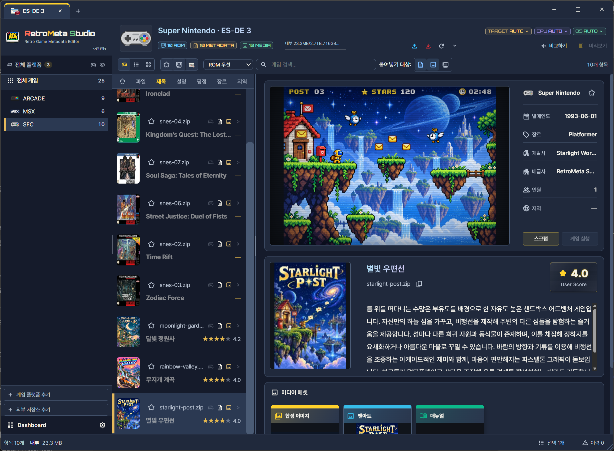
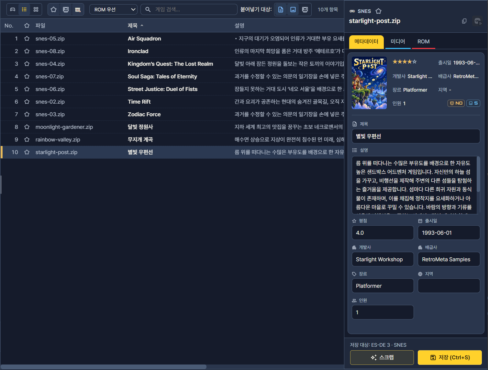
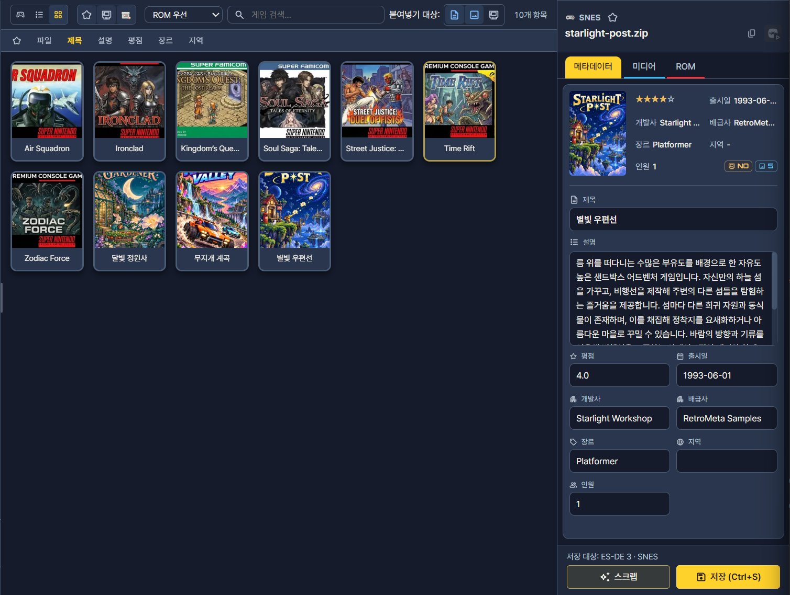
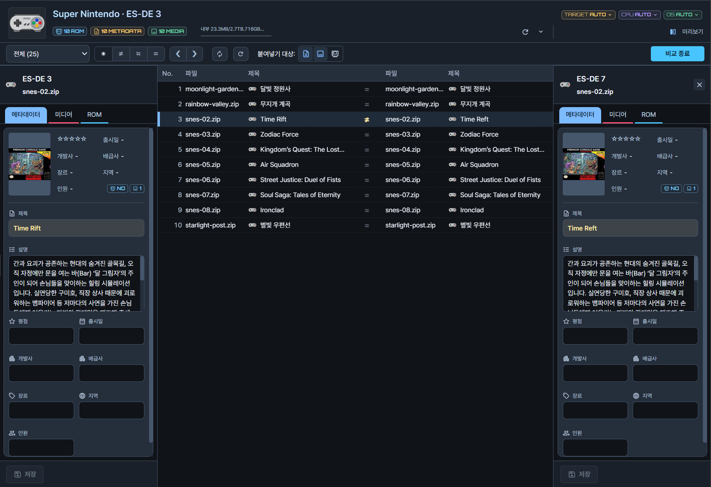

# RetroMeta Studio

**One workspace to browse, edit, compare, and transfer your retro game libraries.**

A free Windows desktop app for game metadata, artwork, media, and optional ROM management across **ES-DE · EmulationStation · Pegasus · LaunchBox**.

**English** · [한국어](README.ko.md)

[**Website**](https://moning-1664.github.io/retro-meta-studio-releases/v0.8/) · [**Getting started**](https://moning-1664.github.io/retro-meta-studio-releases/v0.8/getting-started.html) · [**User manual**](https://moning-1664.github.io/retro-meta-studio-releases/v0.8/manual/index.html) · [**Downloads**](https://github.com/moning-1664/retro-meta-studio-releases/releases) · [**Q&A**](https://github.com/moning-1664/retro-meta-studio-releases/discussions/categories/q-a)

> **v0.8 is being prepared for release.** The screenshots and feature overview below show the v0.8b development version. **The currently available download is v0.6b**; v0.8 installers have not been published. The illustrated manual is currently in Korean.

## Your collection, in three views

Use **Arcade** to see the game screen, cover, and description together. Switch to **List** to compare fields across many games, or **Card** to browse covers. Search, filters, sorting, and the detail editor stay part of the same workspace.

| List view | Card view |
|---|---|
|  |  |
| Inspect filenames, titles, ratings, and other columns. | Find games visually by their covers. |

## What you can do

| Task | In RetroMeta Studio |
|---|---|
| **Open multiple libraries** | Register game-list folders as Collections and switch between tabs. Configure metadata, media, and ROM locations for each format. |
| **Edit metadata and media** | Update titles, descriptions, ratings, and artwork. Check the destination before saving; inspect the original metadata in the advanced editor. |
| **Compare and transfer** | Compare two Collections side by side. Choose the direction and whether to include metadata, media, or ROMs; review the applicable conflict and overwrite options. |
| **Keep a reusable Archive** | Store selected game information and media with revision history. Compare records and choose the preferred revision for a game. |
| **Scrape and translate descriptions** | Review ScreenScraper candidates before choosing fields and media. Export descriptions as CSV, translate the `translated` column in an external tool, and review the file before applying it. |
| **Manage storage and connections** | Inspect storage usage and missing data in Dashboard, manage external storage, and connect Android devices through MTP or ADB where the operation is supported. |
| **Launch and inspect local games** | Configure RetroArch and cores, choose a core for a system or game, and calculate ROM SHA256 values. RetroArch, cores, and ROMs are prepared separately. |

### Compare before choosing what to bring across

Copy/paste, comparison, Collection import, and Archive reuse serve different purposes. [Choose the transfer method that fits your task](https://moning-1664.github.io/retro-meta-studio-releases/v0.8/manual/choose-transfer.html) and check the destination, direction, and included data before applying changes.

## Start with a small collection

1. Open **My game list** from the welcome screen, or use **+** beside the tabs. Choose the game-list folder and its format.
2. Select a system and a game. Edit the title or description and confirm the save destination.
3. Open a second Collection when you want to compare or copy data. Enable ROM management only when you intend to manage ROM files too.

The [illustrated beginner guide](https://moning-1664.github.io/retro-meta-studio-releases/v0.8/getting-started.html) includes a sample download so you can practise opening, searching, editing, saving, and copying without using your own library. The sample contains fictional metadata and media, **no ROMs**.

## Find the right guide

| Getting started | Editing | Moving information | Maintenance |
|---|---|---|---|
| [Open a Collection](https://moning-1664.github.io/retro-meta-studio-releases/v0.8/manual/collections.html) | [Metadata and media](https://moning-1664.github.io/retro-meta-studio-releases/v0.8/manual/editing.html) | [Copy and paste](https://moning-1664.github.io/retro-meta-studio-releases/v0.8/manual/clipboard.html) | [Archive and revisions](https://moning-1664.github.io/retro-meta-studio-releases/v0.8/manual/archive.html) |
| [Screen layout](https://moning-1664.github.io/retro-meta-studio-releases/v0.8/manual/screens.html) | [Online scraping](https://moning-1664.github.io/retro-meta-studio-releases/v0.8/manual/scrape.html) | [Compare Collections](https://moning-1664.github.io/retro-meta-studio-releases/v0.8/manual/compare.html) | [Files and storage](https://moning-1664.github.io/retro-meta-studio-releases/v0.8/manual/files.html) |
| [Views and navigation](https://moning-1664.github.io/retro-meta-studio-releases/v0.8/manual/views.html) | [CSV translation with Google Sheets](https://moning-1664.github.io/retro-meta-studio-releases/v0.8/manual/csv.html#google-sheets) | [Import from a Collection](https://moning-1664.github.io/retro-meta-studio-releases/v0.8/manual/import.html) | [Troubleshooting](https://moning-1664.github.io/retro-meta-studio-releases/v0.8/manual/troubleshooting.html) |

The repository's **About → website** link opens the manual directly. [Browse all manual topics](https://moning-1664.github.io/retro-meta-studio-releases/v0.8/manual/index.html) · [Read the v0.8 development notes](https://moning-1664.github.io/retro-meta-studio-releases/v0.8/release-notes.html).

## Download and compatibility

- **Available now: [v0.6b for Windows x64](https://github.com/moning-1664/retro-meta-studio-releases/releases/tag/v0.6b).** Use the Setup executable or Portable ZIP attached to that release. GitHub's **Code ZIP / Source code** archives are not the built app.
- Python is included. The app uses Microsoft WebView2; installing the runtime may require an internet connection.
- The v0.8 screenshots and new manual describe the development version and can differ from v0.6b. [v0.6b usage guide](HOW_TO_USE.md) · [v0.6b release notes](RELEASE_NOTES.md).
- Supported game-list formats are ES-DE, EmulationStation, Pegasus, and LaunchBox. Fields and available operations vary by format and storage connection. The app itself runs on Windows.
- ScreenScraper needs a working service connection and the appropriate account/access. Service limits and available metadata affect results; integration does not imply endorsement.
- English, Korean, Japanese, Spanish, and French UI languages are available. Comprehensive clean-PC and device validation for the upcoming v0.8 release is still pending.

## Questions and reports

Use [GitHub Q&A](https://github.com/moning-1664/retro-meta-studio-releases/discussions/categories/q-a). Include your app version, Windows version, game-list format, connection type, and steps to reproduce the issue. [Troubleshooting and recovery](https://moning-1664.github.io/retro-meta-studio-releases/v0.8/manual/troubleshooting.html) explains how to interpret read failures, external changes, and folder reconnection notices.

Before posting screenshots or logs, remove passwords, tokens, and personal paths. Keep backups of your game lists before editing or transferring files.

## Free use and responsibility

RetroMeta Studio is provided free of charge for lawful use. Users are responsible for ensuring they have the necessary rights to any ROMs, BIOS files, metadata, images, and other content they process, and for complying with applicable law and third-party service terms. No ROMs, BIOS files, or commercial game artwork are supplied as collection content.

The software is provided as-is. To the extent permitted by applicable law, no warranty of accuracy, fitness for a particular purpose, or uninterrupted operation is given, and the provider's liability is limited to the extent permitted by law. These terms do not exclude liability for intentional misconduct, gross negligence, or any liability that cannot legally be excluded. Review file operations and maintain backups.

Free use does not grant a license to the private source code. Third-party components remain subject to their own license terms; see the notices included with the download. Product and service names identify compatible formats and integrations and do not imply affiliation, sponsorship, or endorsement.
